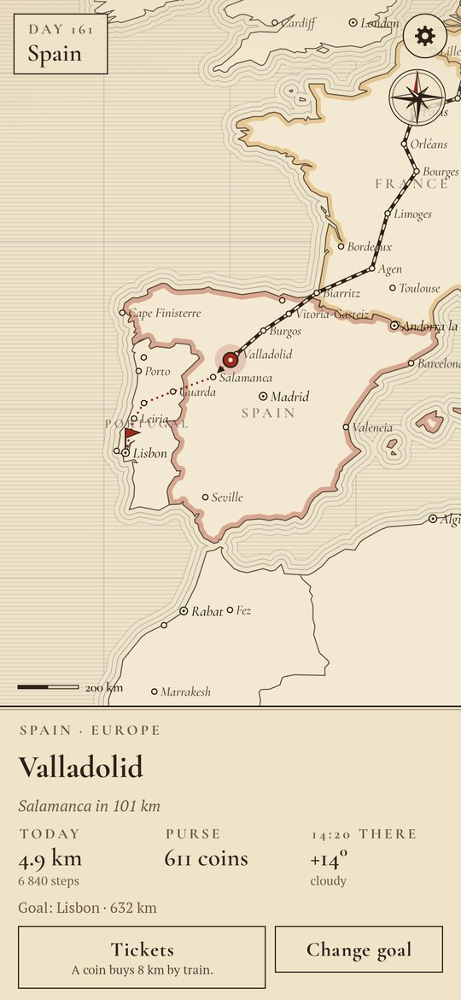
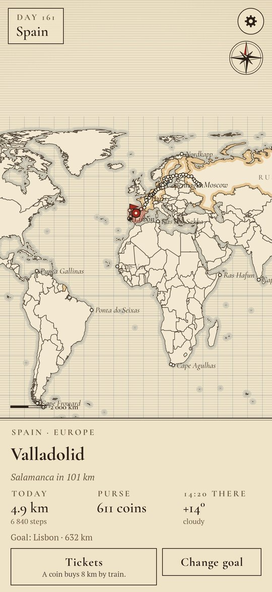
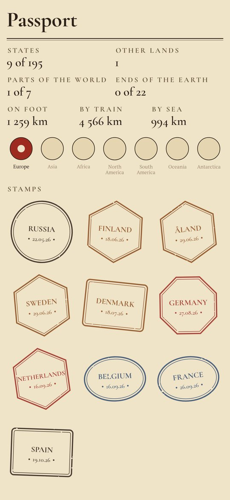
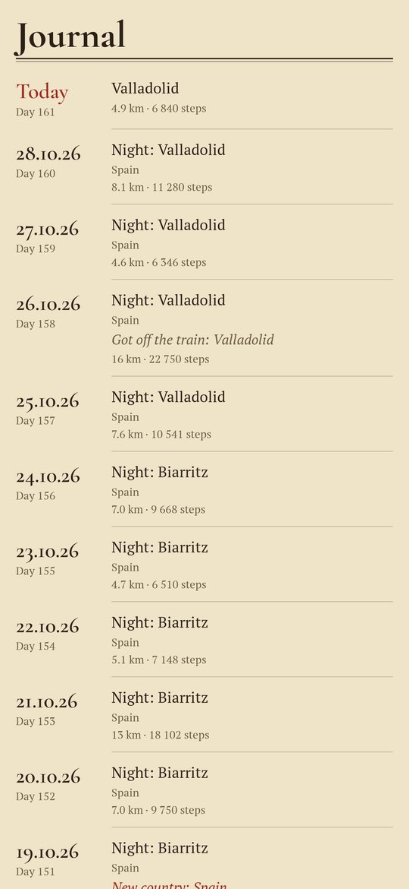

<div align="center">

# Farwalker

### A pedometer that walks you round the real world.

*Your steps carry a traveller across the real map of the world: along its roads, over its borders, across its seas. Every kilometre walked is a coin for a train or a ship's passage. Every border is a stamp in the passport. The world is big: this is a journey of years. Free, no ads, no account.*

[](https://github.com/bigdevwhale/farwalker/actions/workflows/android.yml)


[](LICENSE)

**English** · [Русский](README.ru.md) · [Changelog](CHANGELOG.md)

   

</div>

---

## How it works

1. **Set out from home.** Pick your town; the traveller stands there on an engraved atlas.
2. **Choose a goal.** Any town, any country, any end of the earth: the way goes along real roads between 5,500 towns, and takes a ship where the sea is in the way.
3. **Walk.** The phone's own step counter moves the traveller, even with the app closed. A road is walked kilometre for kilometre.
4. **Coins.** Every kilometre walked is a coin. A coin buys 8 km by train from wherever you are to a station ahead, or 15 km by sea. Trains and ships run on the clock: the ride from Lisbon to New York takes about nine real days at sea.
5. **The passport.** Every border crossed is a stamp, cut from the country's code: 195 states and 47 other lands. The parts of the world fill in, and 22 ends of the earth wait: Cabo da Roca, Nordkapp, Cape Horn, Cape Dezhnev, the South Pole.
6. **Where you are.** The local time where the traveller stands, and the real weather there.
7. **The journal.** Where you slept each night, how far you walked, the borders and the ports.

## Privacy

No account, no ads, no analytics. Steps and the journey stay on the phone. The only network request is the weather: the traveller's coordinates go to Open-Meteo (or to MET Norway when Open-Meteo can't be reached), nothing else.

## Building

```bash
./gradlew testDebugUnitTest assembleDebug        # app.farwalker.dev, next to a real install
./gradlew assembleDebug -Pdemo                   # app.farwalker.demo, five months on the road
./gradlew testDebugUnitTest -Prender --tests '*RenderArt*'   # screens to app/build/art
python tools/world.py                            # rebuilds the world from Natural Earth
```

Kotlin, Jetpack Compose, DataStore, WorkManager. The world is built by `tools/world.py` from [Natural Earth](https://www.naturalearthdata.com) into `app/src/main/assets/world`: country outlines, towns with their time zones, roads that stay on land (with the borders along each), sea lanes, and a few real bridges and tunnels. The map is drawn in code, engraver-style: hatched seas, ripples along the coasts, hand-coloured borders. `TravelTest` walks Moscow to Lisbon, sails Lisbon to New York and checks the whole world hangs together.

## License

[MIT](LICENSE). Maps: Natural Earth (public domain). Fonts: Cormorant and PT Serif (SIL OFL). Weather: [Open-Meteo.com](https://open-meteo.com) and [MET Norway](https://api.met.no) (CC BY 4.0).
