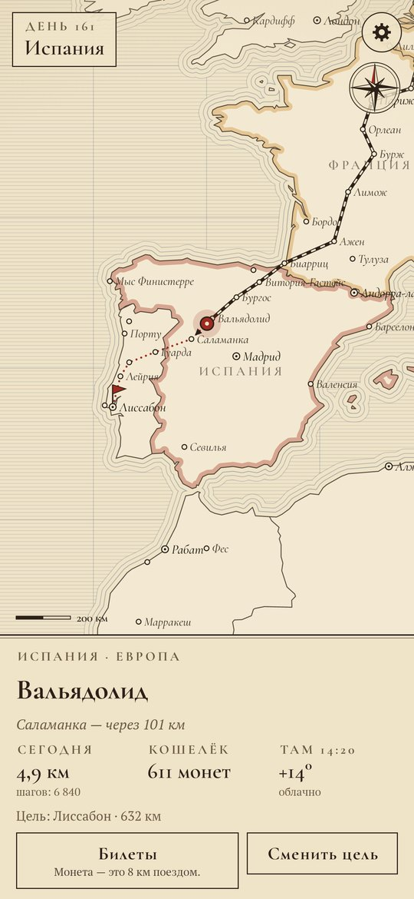
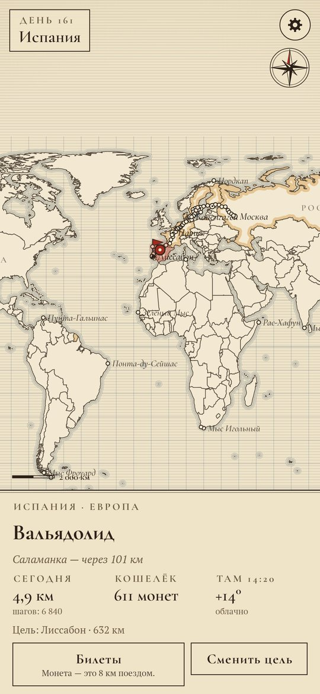
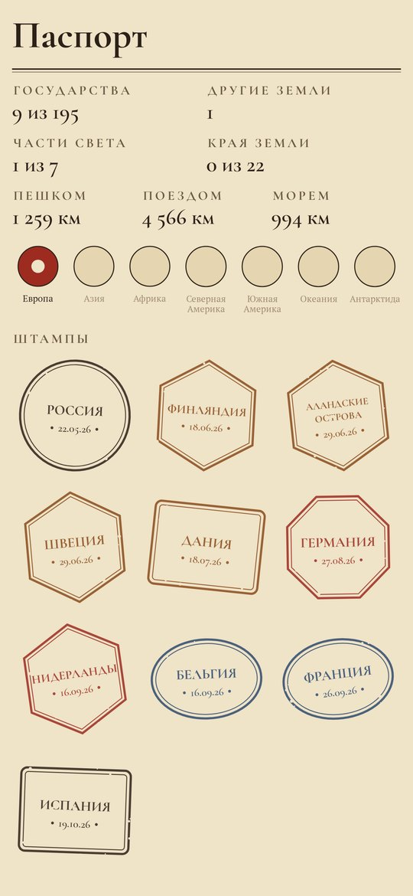
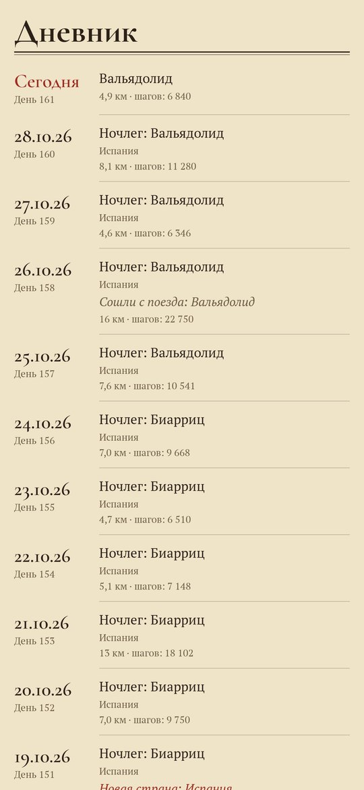

# Кругосветка

### Шагомер, который ведёт вас вокруг настоящего света.

*Ваши шаги ведут путника по настоящей карте мира: по дорогам, через границы и моря. Каждый пройденный километр — монета на поезд или корабль. Каждая граница — штамп в паспорте. Мир большой, и это путешествие на годы. Бесплатно, без рекламы и регистрации.*

[English](README.md) · **Русский** · [Изменения](CHANGELOG.md)

   

---

## Как это устроено

1. **Выходим из дома.** Выберите свой город, и путник встанет в нём на гравированной карте.
2. **Выбираем цель.** Любой город, любая страна, любой край земли. Путь идёт по настоящим дорогам между 5 500 городами, а где мешает море — на корабле.
3. **Идём.** Путника двигает встроенный шагомер телефона, даже когда приложение закрыто. Дорога проходится километр за километром.
4. **Монеты.** Каждый пройденный километр — монета. За монету можно проехать 8 км поездом (с любого места до станции впереди) или 15 км морем. Поезда и корабли идут по часам: из Лиссабона в Нью-Йорк — около девяти настоящих дней в море.
5. **Паспорт.** Каждая пересечённая граница — штамп, у каждой страны свой: 195 государств и 47 других земель. Заполняются части света, и ждут 22 края земли: мыс Рока, Нордкап, мыс Горн, мыс Дежнёва, Южный полюс.
6. **Где вы сейчас.** Местное время там, где стоит путник, и настоящая погода.
7. **Дневник.** Где ночевали, сколько прошли, какие границы и порты остались позади.

## Скачать

**[Скачать в Google Play](https://play.google.com/store/apps/details?id=app.farwalker)**.

Или возьмите **Farwalker.apk** в [последнем релизе](https://github.com/bigdevwhale/farwalker/releases/latest) и откройте на телефоне (разрешите установку из браузера или файлового менеджера, когда Android спросит). Android 9 и новее.

## Приватность

Ни аккаунта, ни рекламы, ни аналитики. Шаги и путь хранятся на телефоне. Единственный запрос в сеть — погода: координаты путника уходят в Open-Meteo (или в MET Norway, если Open-Meteo недоступен), больше ничего.

## Лицензия

[MIT](LICENSE). Карты: Natural Earth (общественное достояние). Шрифты: Cormorant и PT Serif (SIL OFL). Погода: [Open-Meteo.com](https://open-meteo.com) и [MET Norway](https://api.met.no) (CC BY 4.0).
